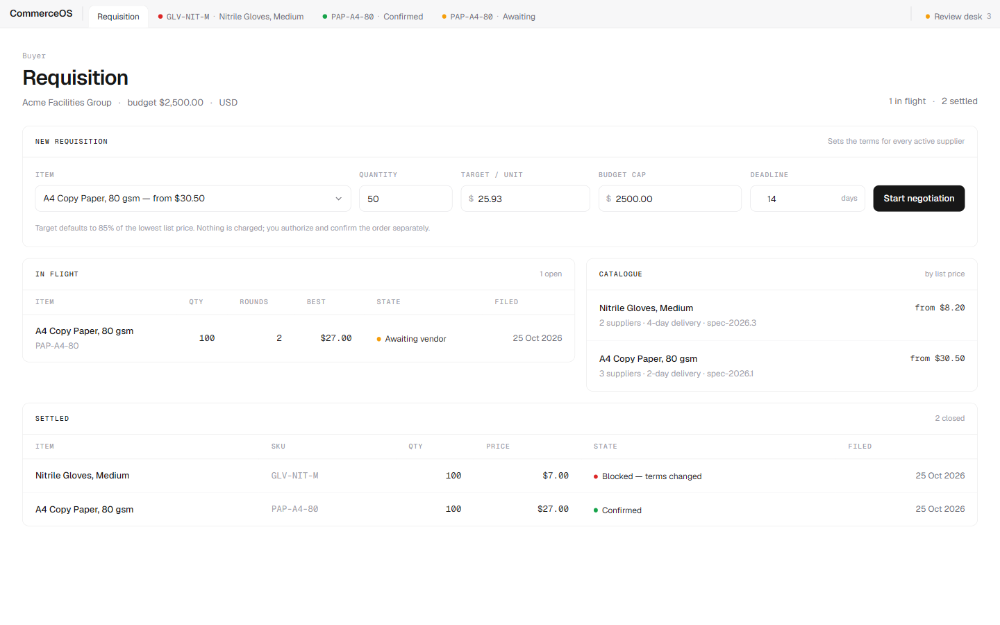
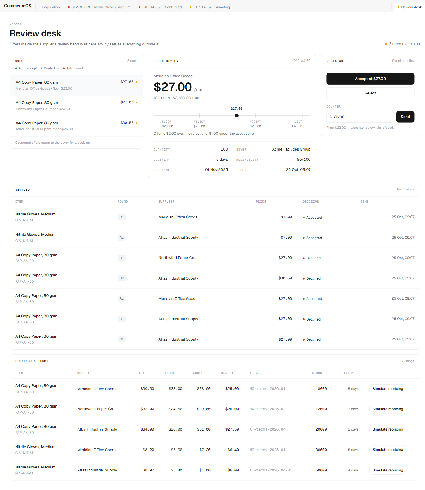
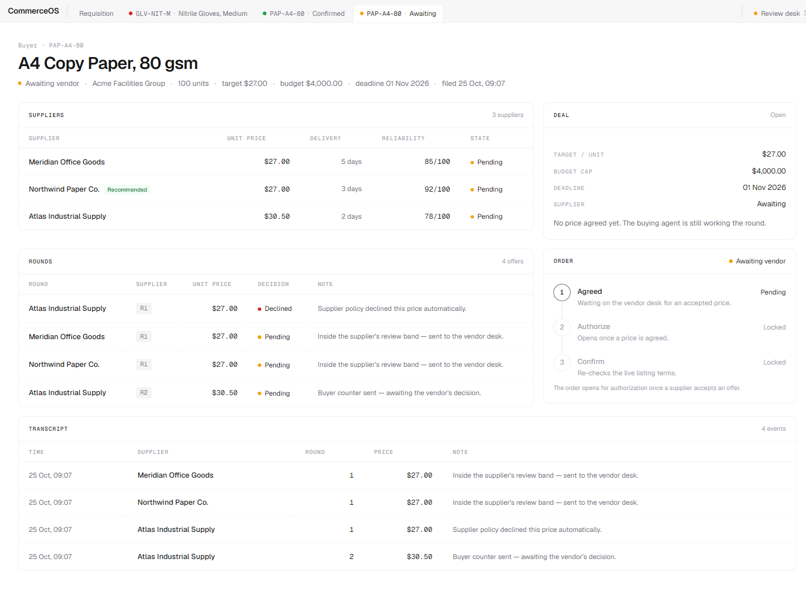
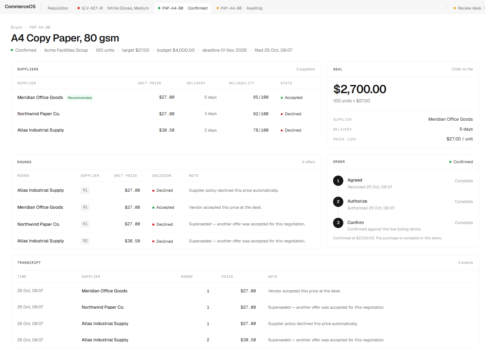
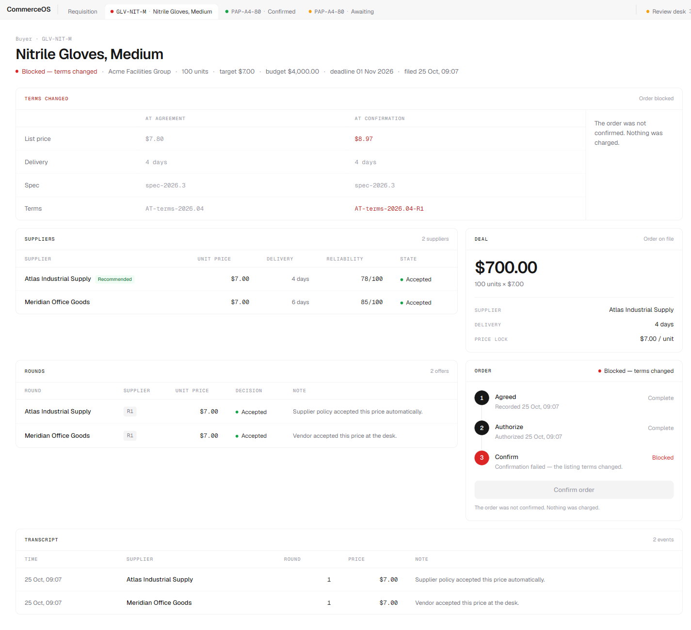
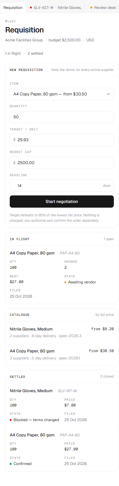

# CommerceOS

**Agent-to-agent procurement, with a human in the loop.** A working demo where
buyer and supplier agents negotiate automatically, a person at the vendor desk
decides the genuinely borderline offers, and the buyer authorizes and confirms
the resulting order. There is no payment layer — "completing the transaction"
means the order is confirmed.



## What it demonstrates

- **Deterministic negotiation, no LLM.** Every price, decision and total is
  plain TypeScript. The supplier agent auto-accepts at or above a threshold,
  auto-rejects below another, and sends everything in between to a human.
- **A real human decision point.** Borderline offers land on a vendor review
  desk with a policy band showing exactly where the price sits between floor,
  reject line, accept line and list price.
- **Two-sided authority.** The vendor can accept, reject or counter; the buyer
  must explicitly authorize and then confirm. Counters go back to the buyer for
  a decision.
- **Terms are frozen at agreement.** If the supplier reprices or changes terms
  before confirmation, the confirmation is blocked and the old and new values
  are shown side by side. Nothing is charged.
- **Buyer-safe data.** Supplier floors and thresholds exist only on the vendor
  side; the buyer read models never carry them.

## Screens

### Review desk

Pending offers with the policy band, and accept / reject / counter.



### Negotiation — awaiting vendor

Every supplier round, the deal facts, and the order gate.



### Negotiation — confirmed

Agreed, authorized and confirmed against the live terms.



### Negotiation — blocked

Terms changed after agreement, so confirmation failed.



### Mobile

The same screens with tables stacked into label/value blocks.



## How it works

```
requisition ─► deterministic rounds ─► vendor desk ─► agreed ─► authorize ─► confirm
                                          │                        │
                                          └─ counter ─► buyer ─────┘        └─ terms changed? ─► blocked
```

**Decision bands.** Each listing carries two thresholds. For a given offer:

| Offer price | Supplier agent | Human |
| --- | --- | --- |
| `>= autoAcceptFloorMinor` | accepts | not involved |
| `< autoRejectBelowMinor` | rejects | not involved |
| in between | leaves it pending | accepts, rejects or counters on the review desk |

**Rounds.** The buyer opens on its target price, clamped to the supplier floor
and to its per-unit budget. Rejected offers are countered by closing half the
gap to list price, for at most three rounds. Offers that survive are ranked by
price, then delivery days, then supplier reliability.

**The order.** When an offer is accepted, the server creates the order and
computes `totalMinor` itself. The buyer authorizes, then confirms. Confirmation
re-reads the live listing and item and compares them with the terms frozen at
agreement; any difference sets the order to `BLOCKED` with a reason.

## The interface

The app is a tabbed workspace rather than a sidebar dashboard: a top strip with
**Requisition**, a tab per recent negotiation (labelled by state when two are
for the same item) and a pinned **Review desk** with the pending count. Screens
are built from modules on a 12-column grid. State is always a dot plus a word —
amber waiting, red blocked or declined, green agreed or confirmed. No gradients,
no icons, no charts.

## Stack

- Next.js 16 (App Router, Turbopack) · React 19 · TypeScript
- Prisma 6 + SQLite · server actions for every mutation
- Tailwind CSS v4
- Vitest for the negotiation engine

## Run locally

Prerequisites: Node.js 20.9+ and npm.

```bash
git clone https://github.com/leacvikas0/commerceos.git
cd commerceos
npm install

cp .env.example .env          # DATABASE_URL="file:./dev.db"
npx prisma migrate dev        # creates prisma/dev.db
npx prisma db seed            # catalogue + three demo negotiations
npm run dev                   # http://localhost:3000
```

The seed drives three negotiations through the real service, so the app opens
with all three states worth showing:

| Scenario | State on open |
| --- | --- |
| Paper, target $27.00 | **Awaiting vendor** — three borderline offers on the desk |
| Paper, same target, vendor accepts Meridian | **Confirmed** — authorized and confirmed |
| Gloves, vendor accepts, supplier reprices | **Blocked** — terms changed before confirmation |

Useful commands:

| Command | What it does |
| --- | --- |
| `npm run dev` | dev server |
| `npm run build` | production build |
| `npm test` | unit tests for the negotiation engine |
| `npx prisma db seed` | reset to the seeded demo state |
| `npx tsx scripts/e2e.ts` | server-flow checks (cleans up after itself) |
| `npx tsx scripts/smoke.ts` | run one negotiation and print its rounds |

## Deploying it

The app is a standard Next.js server app with a SQLite database file. Any host
that can run Node and keep a disk between restarts will work — a small VPS, or
Render / Fly.io / Railway with a persistent volume mounted at `prisma/`.

```bash
npm ci
npx prisma migrate deploy      # apply migrations, no prompts
npx prisma db seed             # first deploy only; wipes demo data
npm run build
npm start                      # honours PORT, defaults to 3000
```

Environment: `DATABASE_URL` (SQLite file path) and `PORT`.

> **Serverless caveat:** Vercel and similar platforms have an ephemeral,
> read-only filesystem, so SQLite writes will not survive. To host there, switch
> the Prisma datasource to Postgres and regenerate migrations — the rest of the
> code is unchanged.

## Project layout

```
src/
├─ app/                 routes, layout, server actions, global styles
│  ├─ page.tsx          requisition workspace (buyer)
│  ├─ vendor/page.tsx   vendor review desk
│  └─ negotiation/[id]/ negotiation detail (buyer)
├─ components/          shell, storefront, vendor and negotiation modules
└─ lib/
   ├─ negotiation.ts        pure engine: bands, counters, ranking, status
   ├─ negotiation-service.ts DB orchestration: rounds, order, confirm gate
   ├─ queries.ts            read models (buyer DTOs exclude floors)
   ├─ db.ts                 Prisma client
   └─ format.ts             integer-minor money handling
prisma/
├─ schema.prisma        Item, Supplier, Listing, Buyer, Negotiation, Offer, Order
├─ seed.ts              catalogue + three driven demo negotiations
└─ migrations/
scripts/
├─ e2e.ts               confirm, reprice-block and vendor-counter flows
└─ smoke.ts             prints one negotiation's rounds
```

## Tests

`npm test` covers the pure engine: the three decision bands including boundary
values, the opening offer clamp, counter-offer arithmetic, status roll-up and
deal ranking.

`scripts/e2e.ts` drives the real database through three flows — vendor accept →
authorize → confirm, supplier repricing → blocked confirmation, and vendor
counter → buyer accepts counter — asserting totals, the block reason and the
counter price. It deletes the rows it creates and restores any listing it
repriced.

## Limitations

This is a demo, not a production procurement system:

- no authentication or roles — one seeded buyer and an open vendor desk;
- no payment layer (by design) and no inventory reservation;
- single tenant, and no locking beyond the order's unique negotiation reference;
- the seed resets the demo data.

## License

MIT — see [LICENSE](LICENSE).
